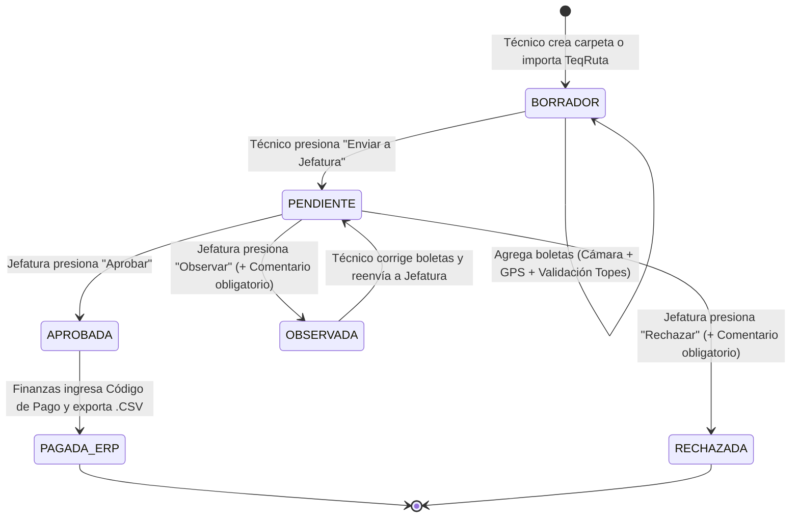
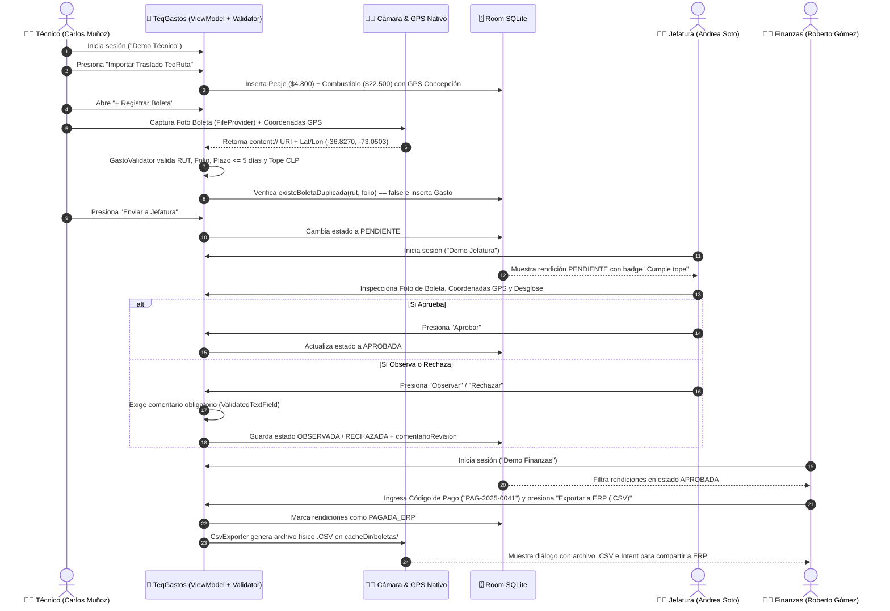

# 🔄 3. Flujo Completo del MVP y Matriz de Indicadores de Evaluación (IEE)

**Proyecto:** TeqGastos — TEQMED SPA  
**Integrantes:** Horacio Navarrete y Maximiliano Ojeda  

---

## 1. Máquina de Estados de una Rendición (`RendicionEntity`)

Cada carpeta de rendición atraviesa un ciclo de vida trazable de principio a fin en Room:

---

## 2. Secuencia End-to-End entre los 3 Roles del MVP

---

## 3. Matriz de Cumplimiento de Indicadores de Evaluación (IEE / Rúbrica)

| Indicador | Criterio de Evaluación Exigido | Evidencia Exacta en el Código Fuente |Cómo se verifica en Android Studio |
| :--- | :--- | :--- | :--- |
| **IE 2.1.1** | **Diseño de Interfaz Móvil y Navegación Estructurada** | • Sistema de diseño fiel a Figma en [`TeqTheme.kt`](../app/src/main/java/cl/duoc/teqgastos/ui/theme/TeqTheme.kt) y [`TeqFigmaComponents.kt`](../app/src/main/java/cl/duoc/teqgastos/ui/components/TeqFigmaComponents.kt). • Navegación declarativa con transiciones suaves en [`AppNavGraph.kt`](../app/src/main/java/cl/duoc/teqgastos/ui/navigation/AppNavGraph.kt). • Secciones completas de `Inicio`, `Rendiciones`, `Reportes` y `Ajustes` (adaptable Android/iOS) en [`TeqAdaptiveSections.kt`](../app/src/main/java/cl/duoc/teqgastos/ui/components/TeqAdaptiveSections.kt). | Navegar entre Login, Técnico, Formulario de Gasto, Jefatura y Finanzas observando las transiciones `fadeIn + slideInHorizontally` y probando las 4 pestañas inferiores. |
| **IE 2.1.2** | **Gestión de Estado con Arquitectura MVVM y `StateFlow`** | • 4 ViewModels desacoplados: [`AuthViewModel.kt`](../app/src/main/java/cl/duoc/teqgastos/ui/screens/auth/AuthViewModel.kt), [`TecnicoViewModel.kt`](../app/src/main/java/cl/duoc/teqgastos/ui/screens/tecnico/TecnicoViewModel.kt), [`JefaturaViewModel.kt`](../app/src/main/java/cl/duoc/teqgastos/ui/screens/jefatura/JefaturaViewModel.kt) y [`FinanzasViewModel.kt`](../app/src/main/java/cl/duoc/teqgastos/ui/screens/finanzas/FinanzasViewModel.kt). • Uso exclusivo de `StateFlow` y `collectAsStateWithLifecycle()`. | Rotar la pantalla o cambiar de pestaña y comprobar que el estado del formulario y los filtros se mantienen intactos. |
| **IE 2.2.1** | **Validaciones Desacopladas de Lógica de Negocio** | • [`GastoValidator.kt`](../app/src/main/java/cl/duoc/teqgastos/domain/validators/GastoValidator.kt):   - `validarRutProveedor(rut)`   - `validarFolioBoleta(folio)`   - `validarFechaGasto(fechaMillis)` (máx. 5 días, no futura)   - `convertirAClp(monto, moneda)` (`UF=$38.000`, `USD=$950`)   - `validarTopePorCategoria(...)` (5 categorías)   - `validarFotoComprobante(fotoUri)`   - `validarComentarioRevision(...)` | En `FormularioGastoScreen`, ingresar un RUT inválido (`123`), un monto en Alimentación de `$20.000` (supera tope de `$15.000`) o elegir chip `"Hace 7 días (Fuera de plazo)"` y observar el bloqueo inmediato. |
| **IE 2.2.2** | **Componentes Visuales Validados y Animaciones Funcionales** | • [`ValidatedTextField.kt`](../app/src/main/java/cl/duoc/teqgastos/ui/components/ValidatedTextField.kt): Muestra `isError`, `Icons.Default.Error` en rojo o `Icons.Default.CheckCircle` en verde, más `AnimatedVisibility` para el mensaje de error. • `Modifier.animateContentSize()` en las tarjetas de [`TecnicoHomeScreen.kt`](../app/src/main/java/cl/duoc/teqgastos/ui/screens/tecnico/TecnicoHomeScreen.kt) y [`JefaturaScreen.kt`](../app/src/main/java/cl/duoc/teqgastos/ui/screens/jefatura/JefaturaScreen.kt). | Escribir en cualquier campo validado o intentar "Rechazar" en Jefatura dejando el comentario vacío para ver la animación de error con ícono rojo. |
| **IE 2.3.1** | **Persistencia Local Relacional con Room (`SQLite`)** | • Entidades: [`UsuarioEntity.kt`](../app/src/main/java/cl/duoc/teqgastos/data/local/entities/UsuarioEntity.kt), [`RendicionEntity.kt`](../app/src/main/java/cl/duoc/teqgastos/data/local/entities/RendicionEntity.kt), [`GastoEntity.kt`](../app/src/main/java/cl/duoc/teqgastos/data/local/entities/GastoEntity.kt). • DAO: [`TeqGastosDao.kt`](../app/src/main/java/cl/duoc/teqgastos/data/local/dao/TeqGastosDao.kt). • DB: [`AppDatabase.kt`](../app/src/main/java/cl/duoc/teqgastos/data/local/AppDatabase.kt) + [`TeqGastosRepository.kt`](../app/src/main/java/cl/duoc/teqgastos/data/repository/TeqGastosRepository.kt). | Cerrar completamente la app en el emulador, volver a abrirla y verificar que todas las rendiciones creadas, aprobadas o pagadas persisten en SQLite. |
| **IE 2.4.1** | **Acceso Seguro a 2 Recursos Nativos (Cámara y GPS - 15% Rúbrica)** | • [`AndroidManifest.xml`](../app/src/main/AndroidManifest.xml) y [`file_paths.xml`](../app/src/main/res/xml/file_paths.xml). • [`NativeResourcesHelper.kt`](../app/src/main/java/cl/duoc/teqgastos/utils/NativeResourcesHelper.kt): `createImageUri(context)` + `obtenerUbicacionActual(context)`. • [`FormularioGastoScreen.kt`](../app/src/main/java/cl/duoc/teqgastos/ui/screens/tecnico/FormularioGastoScreen.kt): `ActivityResultContracts.TakePicture()` + `RequestMultiplePermissions`. | En `FormularioGastoScreen`, presionar **"Tomar Foto"** (abre la cámara y muestra la miniatura real) y **"Capturar GPS"** (solicita permiso y registra latitud/longitud). |
